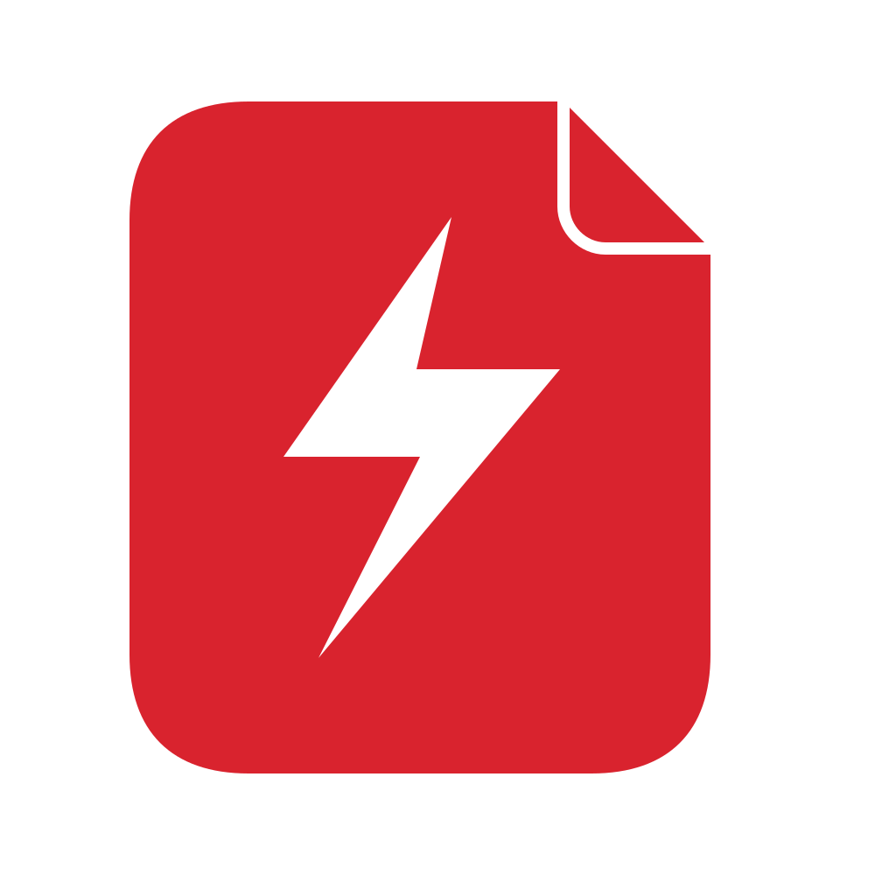

<div align="center">



# Bolt PDF

**A fast, lightweight, privacy-first PDF reader & toolkit for Android — powered by a Rust + PDFium native core and Jetpack Compose.**

[](https://developer.android.com)
[](https://kotlinlang.org)
[](https://www.rust-lang.org)
[](#building-from-source)
[](https://al-hussein-ali.github.io/bolt-pdf/)

[Website](https://al-hussein-ali.github.io/bolt-pdf/) • [Privacy Policy](https://al-hussein-ali.github.io/bolt-pdf/privacy.html) • [Releases](https://github.com/al-hussein-ali/bolt-pdf/releases)

</div>

---

## Features

- **Blazing-Fast Native Rendering** — Powered by a Rust (`pdf_core`) engine wrapping PDFium (`pdfium-render`), memory-mapped I/O (`memmap2`), an LRU page cache, and zero-copy JNI bitmap transfers (`NativeZeroCopy`) for smooth scrolling and zooming.
- **Smart Text Selection (LTR, RTL & Mixed BiDi)** — Accurate character/word selection with BiDi support, Arabic diacritic ordering, and duplicate-glyph cleanup.
- **Full-Text Search & Reading State** — Fast in-document search, bookmarks/favorites, and automatic reading progress persistence backed by bundled SQLite (`rusqlite`).
- **On-Device PDF Tools** — Built-in PDF tools (`tools.rs`) directly inside the app with zero third-party server uploads.
- **Built-in Markdown Reader** — Clean native Markdown viewer alongside your PDF library.
- **Private Google Drive Cloud Sync** — Optional sync using Google Drive's isolated `appDataFolder` (`drive.appdata` scope) for Recent & On-Device PDFs, reading progress, and favorites — featuring SHA-256 deduplication, quota checks, and conflict resolution.
- **Bilingual Interface** — Complete **English** and **Arabic (العربية)** UI support.

---

## Tech Stack

| Layer | Technologies |
| :--- | :--- |
| **Android UI** | Kotlin, Jetpack Compose (BOM `2024.10.01`), Material 3, ViewModel + StateFlow, Coroutines |
| **Native Bridge** | UniFFI (`0.28`), JNA (`5.14.0`), custom JNI zero-copy bitmap surface (`android_jni.rs`) |
| **Rust Core (`pdf_core`)** | Rust (2021 edition), `pdfium-render` (`0.8`), `rusqlite` (`0.32`, bundled), `memmap2`, `lru`, `image`, `sha2`, `parking_lot` |
| **Cloud Sync & Auth** | Google Play Services Auth (`21.2.0`), Google Drive REST API v3 (`drive.appdata`), OkHttp (`4.12.0`) |
| **Build & Size Optimization** | `opt-level = "z"`, fat LTO, `codegen-units = 1`, `panic = "abort"`, symbol stripping, R8 minification & resource shrinking |

---

## Project Structure

```text
.
├── android/                        # Android Studio / Gradle project (com.bolt.pdf)
│   └── app/src/main/java/com/velocity/pdf/
│       ├── MainActivity.kt         # App entry point & navigation host
│       ├── PdfViewModel.kt         # State management, library & sync orchestration
│       ├── GoogleDriveSyncManager.kt # Google Sign-In & Drive appDataFolder REST client
│       ├── NativeZeroCopy.kt       # Direct JNI bitmap rendering bridge
│       └── ui/
│           ├── HomeScreen.kt       # Recent, On Device & Favorites library UI
│           ├── ReaderScreen.kt     # PDF viewer, zoom, search & BiDi text selection
│           ├── PdfToolsScreens.kt  # On-device PDF toolkit UI
│           ├── MarkdownReaderScreen.kt # Built-in Markdown reader
│           ├── SettingsScreen.kt   # Theme, language & Cloud Sync settings
│           ├── AppStrings.kt       # English & Arabic localization
│           └── Theme.kt            # Material 3 theming
├── pdf_core/                       # Rust native PDF engine (cdylib + staticlib + rlib)
│   └── src/
│       ├── lib.rs                  # UniFFI public API & core initialization
│       ├── renderer.rs             # PDFium page rendering & text extraction
│       ├── cache.rs                # LRU page & bitmap cache
│       ├── search.rs               # Full-text PDF search
│       ├── db.rs                   # SQLite library, progress & favorites storage
│       ├── tools.rs                # On-device PDF manipulation tools
│       ├── android_jni.rs          # Zero-copy Android Bitmap JNI integration
│       └── bin/uniffi-bindgen.rs   # UniFFI Kotlin bindings generator
├── scripts/                        # Cross-compilation & UniFFI build scripts
│   ├── build_android.ps1           # Windows PowerShell build script
│   └── build_android.sh            # Linux/macOS build script
├── docs/                           # GitHub Pages landing page & Privacy Policy
├── logos/                          # Brand vector & raster assets
├── Cargo.toml                      # Rust workspace & release size-optimization profile
└── use-project-env.ps1             # Local toolchain environment helper (Windows)
```

---

## Building from Source

### Prerequisites

- **Android SDK** (`compileSdk 36`, `minSdk 26`, `arm64-v8a` NDK)
- **JDK 17**
- **Rust** toolchain with `aarch64-linux-android` target (`rustup target add aarch64-linux-android`)
- **PDFium** prebuilt Android (`arm64-v8a`) library

### Build Steps

1. **Build the Rust native library & generate UniFFI Kotlin bindings:**
   ```powershell
   # Windows (PowerShell)
   .\scripts\build_android.ps1
   ```
   ```bash
   # Linux / macOS
   ./scripts/build_android.sh
   ```

2. **Build the Android APK:**
   ```powershell
   cd android
   .\gradlew assembleDebug     # or .\gradlew assembleRelease (requires keystore.properties)
   ```

---

## Privacy & Security

- **Local-First by Default:** All PDF rendering, search, and document tools run 100% locally on your device.
- **Scoped Cloud Sync:** When you choose to enable Google Drive Sync, Bolt PDF only requests the `https://www.googleapis.com/auth/drive.appdata` scope — it can only access its own hidden app data folder and **cannot** read or modify any other files in your Google Drive.
- Read the full [Privacy Policy](https://al-hussein-ali.github.io/bolt-pdf/privacy.html).
